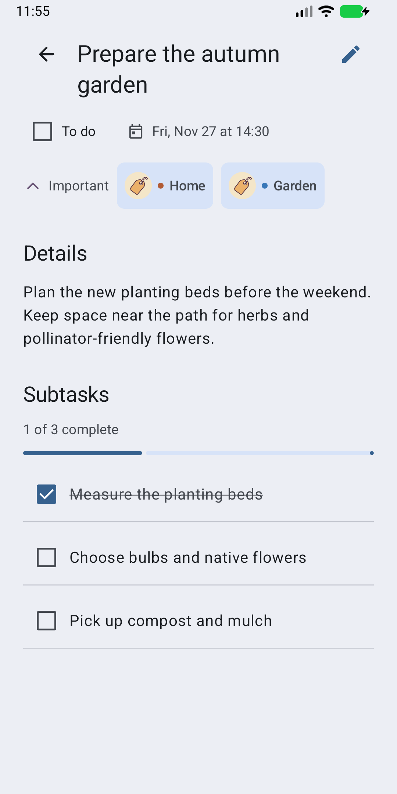
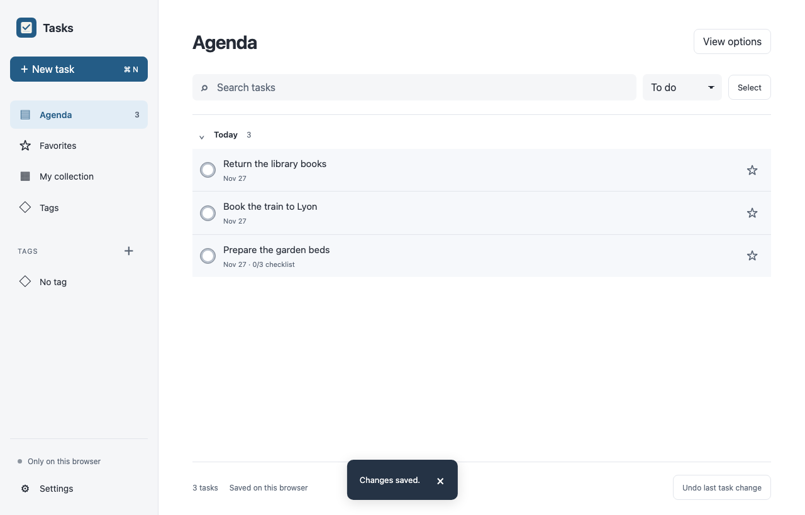

# Tasks

Plan your day on Android or in a browser. Give a task a due date to put it on your agenda, or leave it undated until you’re ready. Open it to keep notes and check off the steps along the way.

[Self-host Tasks](https://github.com/CamilleHbp/sync-core/blob/main/docs/self-hosting.md) · [简体中文](README_ZH.md)

## From a reminder to a checklist

Suppose you need to prepare a garden bed this weekend. Add a task, choose Saturday and set a reminder. Put “measure the bed” and “pick up compost” in its checklist. Checking off one step keeps the task open. Complete the task itself when the bed is ready.

*The garden task keeps the remaining steps beside the notes.*

## Find your next task

Open **Agenda** for dated tasks, including overdue work. On the web, use **My collection** to keep a view with your own dates, tags and sort order. On Android, add an **Upcoming tasks** widget to check things off from the home screen. Each widget remembers its own filters.

*Agenda groups tasks by due date. Open a title to see its notes and checklist.*

## Use the same list on another device

You can [self-host sync](https://github.com/CamilleHbp/sync-core/blob/main/docs/self-hosting.md). In **Synchronization**, enter your server’s HTTPS address and your workspace code on each device. You can work offline after the first load. When two devices edit the same field, Tasks lets you choose which value to keep. The [web and widget guide](pwa/README.md) covers installation, reminders and the macOS and Windows companions.

Install a signed update over VerveTwoDo to keep the Android data. Android data settings can import an older VerveDo ZIP. On the web, importing a JSON backup creates new task IDs. Use sync to keep the same tasks on two devices.

## Project and license

Tasks started as a fork of [VerveDo](https://github.com/Super12138/VerveDo) by Super12138 and contributors. Tasks is maintained independently, including the browser app, shared workspaces, recurring tasks and widgets. Build the Android debug app with `./gradlew :app:assembleDebug`.

[GPL-3.0-only](LICENSE) · [Android component notices](app/licences) · [Upstream translations](https://crowdin.com/project/vervedo) · [Sync library source](https://github.com/CamilleHbp/sync-core/tree/9a048b7e312bff76ecdedebdb2f273e316abc59f) · [Android updater source](https://github.com/CamilleHbp/android-updater/tree/v1.0.5)
