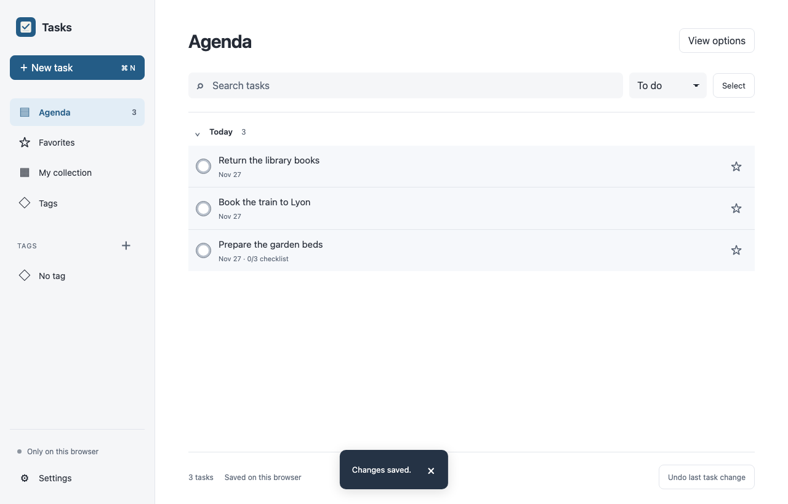
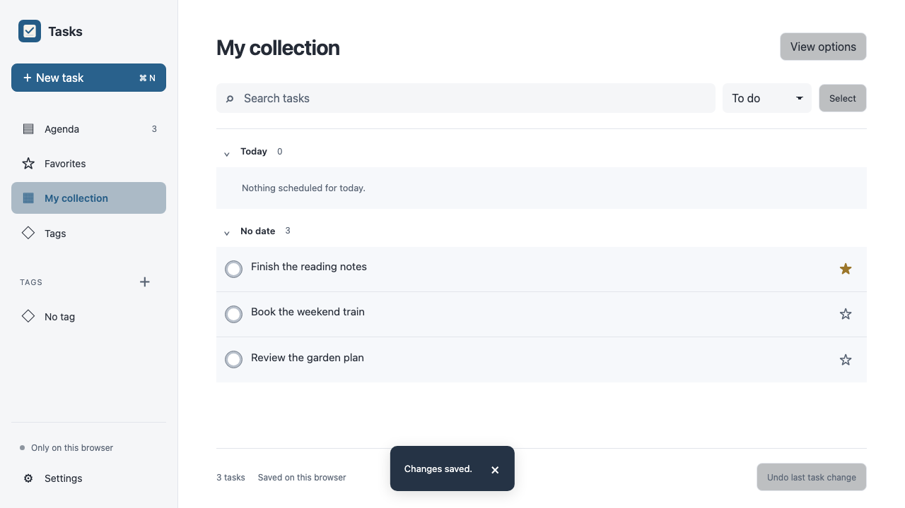
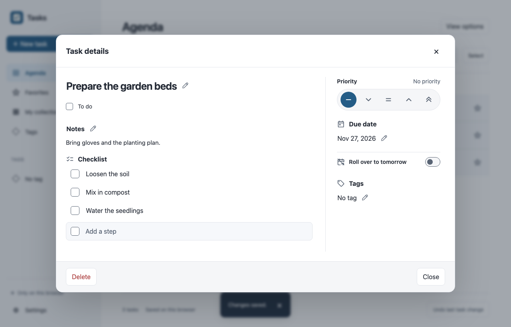
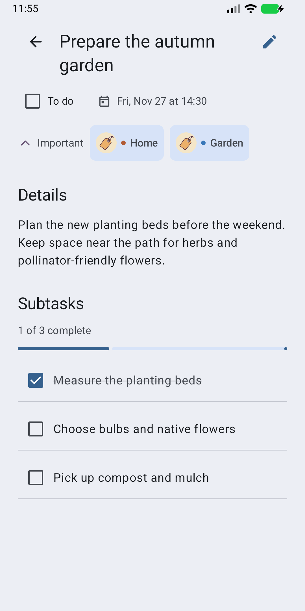

# Tasks

Keep a task’s notes, checklist, due date and reminders together on Android or in your browser. Agenda shows what is due, including unfinished work from earlier days. Tags let you bring related tasks together across dates.

Tasks began as a fork of [VerveDo](https://github.com/Super12138/VerveDo) by Super12138 and contributors. This project maintains the Android app, the desktop web app and their shared synchronization. It adds recurring tasks, per-task carry-forward, editable checklists and configurable widgets.

[简体中文](README.md) · [Android downloads](https://download.camille.studio) · [Desktop web app](https://tasks.camille.studio)

## On your desktop

Build a collection by choosing dates, tags and sort order. Favorite a task to find it from the sidebar. After the first load you can keep working offline. Connect Android and the web app to the same private workspace to synchronize changes. If two devices change the same field, you can choose which value to keep.

*Agenda shows the tasks due today.*

*My collection with three undated tasks.*

*Open a task to edit a checklist step or add another.*

*The Android task view keeps completed checklist steps visible.*

## On Android

Add **Upcoming tasks** from the widget picker. Earlier unfinished tasks appear above today’s work. Each widget remembers its own tags and sorting. Tap a circle to complete a task or tap **+** to add one with the selected date and tag.

## Backups and installation

An update from VerveTwoDo uses the same Android application ID. Install it over the existing signed app to keep its data. To move from upstream VerveDo, export a ZIP in its data settings, then restore the ZIP in Tasks. Restoring replaces local tasks and preferences. CSV contains task data only. Configure Android permissions and widgets separately.

The web app also has a JSON backup. Import adds tasks with new IDs. See the [web app guide](pwa/README.md) for desktop installation, reminders and synchronization. For an Android development build, run `./gradlew :app:assembleDebug`.

## Credits and license

Tasks uses [GPL-3.0-only](LICENSE). The [Android notices](app/licences) cover bundled components. Shared upstream translations come from the [VerveDo translation project](https://crowdin.com/project/vervedo).
