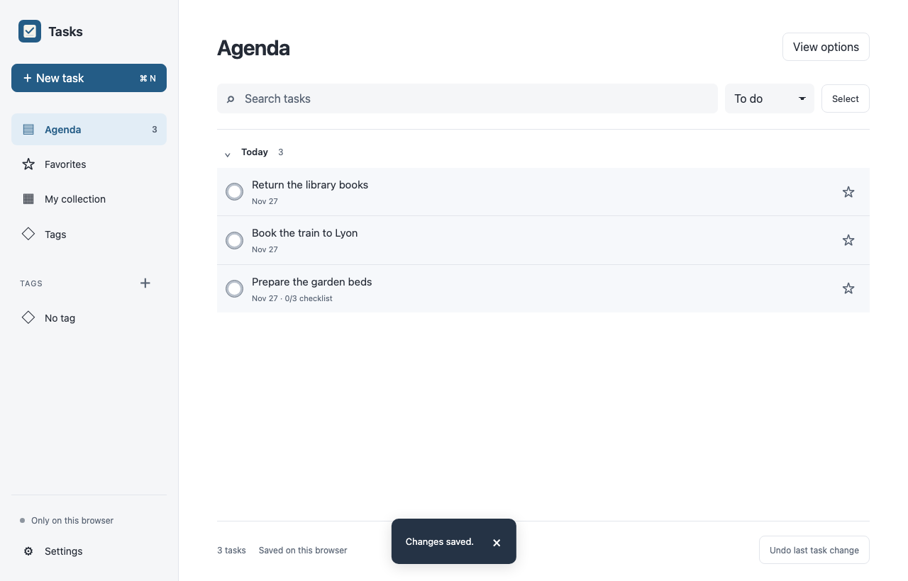
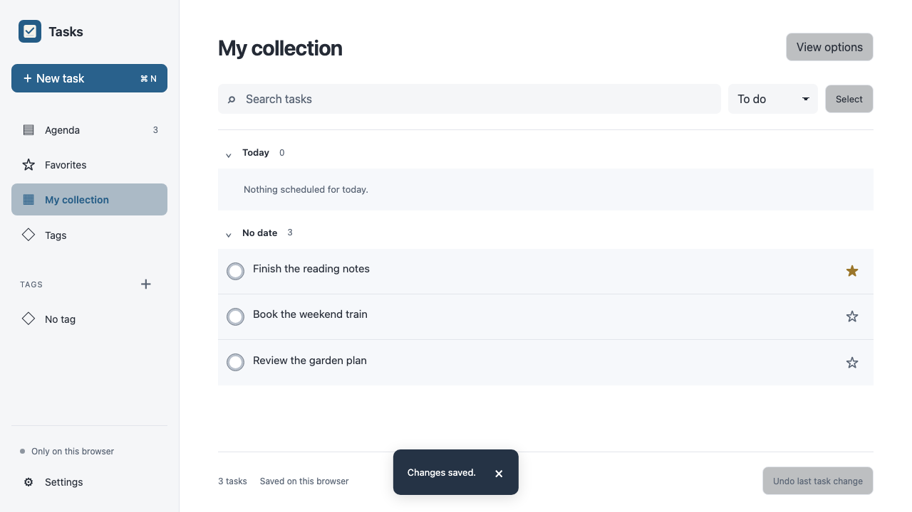
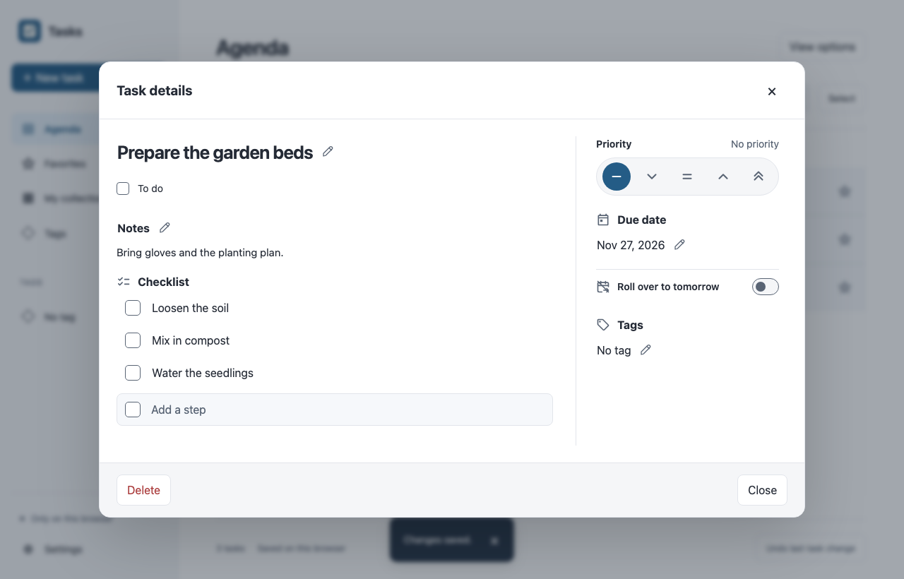
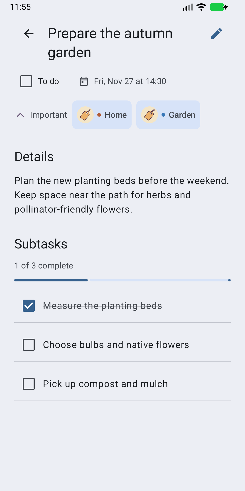

# Tasks

Tasks 可以在 Android 和浏览器里管理待办事项。每项任务都可以设置日期、提醒、标签和重复规则，也可以添加笔记和可逐项勾选的清单。日程视图会把逾期未完成的事项和今天的任务放在一起。

这个项目最初派生自 Super12138 和其他贡献者开发的 [VerveDo](https://github.com/Super12138/VerveDo)，现在独立维护 Android 应用、桌面网页应用以及两者之间的同步。

[English](README.md) · [自行部署网页版和同步服务](https://github.com/CamilleHbp/sync-core/blob/main/docs/self-hosting.md)

## 桌面和手机

在桌面上，可以按日期和标签筛选任务，保存常用视图。首次加载后可以离线使用。手机和电脑连接到同一私人工作区后便可同步。两台设备同时修改同一个字段时，可以选择保留哪个值。

*日程按日期列出待办事项。*

*自定义视图中的三项待办事项。*

*在任务详情中逐项编辑清单。*

Android 主屏幕的近期任务小组件可以单独设置标签和排序方式。轻点圆圈完成任务，轻点加号添加任务。

*Android 任务详情中保留已完成的清单项目。*

## 安装与备份

从 VerveTwoDo 更新时，直接覆盖安装使用相同签名的 APK 即可保留数据。从上游 VerveDo 迁移时，先在其数据设置中导出 ZIP，再到 Tasks 中恢复。导入会添加任务和标签，并保留现有任务和同步连接。CSV 只包含任务数据。Android 权限和主屏幕小组件需要另行设置。桌面 JSON 备份导入后会生成新的任务编号。

有关网页安装和同步的说明，请参阅[网页版指南](pwa/README.md)。运行 `./gradlew :app:assembleDebug` 可以构建 Android 调试版。

## 许可与致谢

Tasks 使用 [GPL-3.0-only](LICENSE) 许可证。第三方组件请参阅 [Android 许可声明](app/licences)。上游翻译来自 [VerveDo 翻译项目](https://crowdin.com/project/vervedo)。

[同步库源代码](https://github.com/CamilleHbp/sync-core/tree/9a048b7e312bff76ecdedebdb2f273e316abc59f)和 [Android 更新程序源代码](https://github.com/CamilleHbp/android-updater/tree/v1.0.5)均采用 Apache 2.0 许可证。
