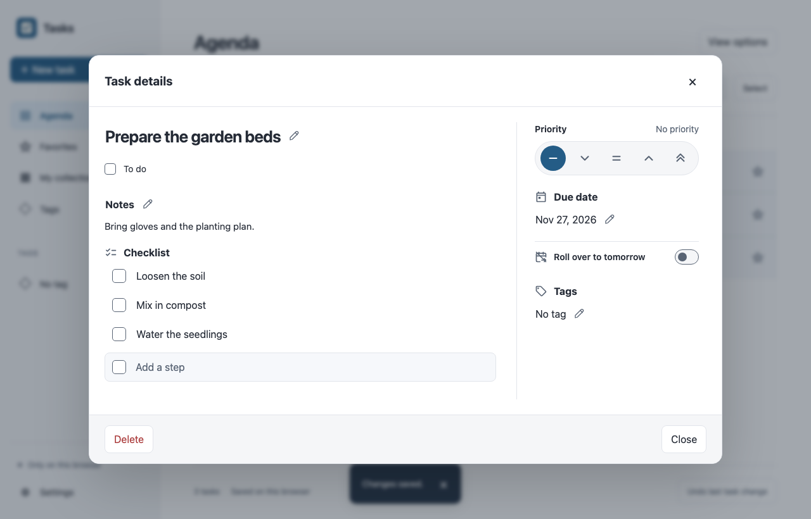

# Tasks for the web

Open your [self-hosted Tasks site](https://github.com/CamilleHbp/sync-core/blob/main/docs/self-hosting.md) to plan your day in a browser. To give Tasks its own window, choose **Install app**, **Add to Dock** or **Add to Home Screen** in your browser. After the first load you can work offline.

## Plan a day

Give a task a due date to see it in **Agenda**. Open the task to write Markdown notes, set its priority or break it into checklist steps. For a repeating task, choose a daily, weekly, monthly or yearly schedule. Turn on carry-forward for unfinished work you want to see the following day.

Use **My collection** to keep your own date range, tag filters and sort order. **Favorites** is a shortcut to individual tasks. Deleting a tag keeps the tasks that used it.

<a href="../docs/screenshots/checklist.png"></a>

*Each checklist step has its own checkbox.*

## Sync, reminders and widgets

Open **Settings → Synchronization**. Use your server’s HTTPS address and the same workspace code on your phone and computer. Offline changes sync when you reconnect. If two devices change the same field, choose which value to keep. Disconnecting revokes this browser’s session and keeps its local tasks.

For a reminder while Tasks is closed, connect the workspace, enable push reminders and allow browser notifications. On iOS or iPadOS, install Tasks on the Home Screen first. With local reminders only, keep Tasks open.

On macOS or Windows 11, open **Settings → Desktop widget** to install the companion, then connect it to your workspace. Select a task in the system widget to open it in Tasks.

## Backups and earlier installs

Export JSON for a backup or CSV for a spreadsheet. Importing JSON adds tasks with fresh IDs. Android ZIP backups belong in the Android app. If you used an earlier web address, sync or export local tasks there first. Each web address has its own storage and notification permission.

[Android app and project credits](../README.md) · [Archived desktop app](../archive/desktop/README.md)

## Development

Development requires Node.js 22.12 or newer, Go 1.27, and the pinned [sync-core](https://github.com/CamilleHbp/sync-core) module.

```sh
cd pwa
npm ci
npm run build
npm test
(cd server && GOWORK=off go test -race ./...)
npm run test:e2e
python3 scripts/test-sync.py
```

The browser tests start the local Go gateway and use isolated browser storage. The synchronization test creates temporary upstream and gateway instances and never reads or writes production tasks.

## Self-hosting

Follow the [sync-core self-hosting guide](https://github.com/CamilleHbp/sync-core/blob/main/docs/self-hosting.md) to run the Tasks site and sync service under your own domain. Use the same HTTPS address on Android and in the browser.

## Credits and license

Tasks builds on VerveDo by super12138. Category artwork and English/French application vocabulary are reused from this repository’s desktop resources. The application is distributed under the repository’s GPL-3.0 license. Third-party libraries retain their respective licenses in the dependency metadata.
